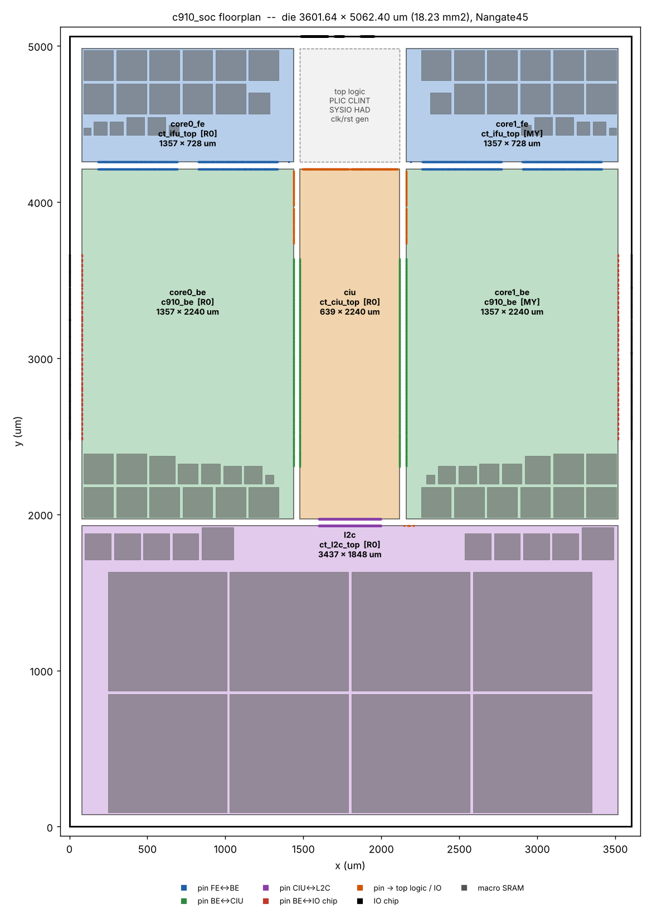

# Spec SoC openC910 – phân chia top và 4 block

Ngày 10/10/2026 · spec v1.0

openC910 nguyên bản (2 core C910, L2 1 MB) được chia thành 4 block cứng và 1 top trên Nangate45, CPU\_CLK 400 MHz (2,5 ns). Mỗi block có tối đa 18 macro SRAM, dưới giới hạn 20. Mọi con số dưới đây được sinh ra từ kết nối RTL đã elaborate, và đi kèm bộ file c910\_soc\_spec.zip.

## Phân chia

Core C910 có 32 SRAM nên không thể làm một block (giới hạn 20 macro). Core được tách thành FE = IFU (18 SRAM) và BE = phần còn lại của core (14 SRAM). Hai core dùng chung một bản cứng của mỗi block: core1 là bản lật MY. CIU và L2C là module có sẵn của openC910.

| Block | Người làm | Module (top của block) | Instance trong chip | Nội dung | Macro | Std cell ước tính | Kích thước (µm) |
| --- | --- | --- | --- | --- | --- | --- | --- |
| FE | Block 1 | `ct_ifu_top` (RTL gốc) | `x_ct_top_0/x_ct_ifu_top`, `x_ct_top_1/x_ct_ifu_top` (MY) | Instruction fetch: I$ 64 KB, BTB, BHT | 18 | 0,15 mm², \~71K cell | 1356,79 × 728,00 |
| BE | Block 2 | `c910_be` (wrapper mới sinh) | `x_ct_top_0/x_c910_be`, `x_ct_top_1/x_c910_be` (MY) | IDU, IU, VFPU, LSU (D$ 64 KB), RTU, CP0, MMU, PMP, BIU, HAD, HPCP | 14 | 1,46 mm², \~680K cell | 1356,79 × 2240,00 |
| CIU | Block 3 | `ct_ciu_top` (RTL gốc) | `x_ct_ciu_top` | Coherence interconnect, snoop buffer, PIU ×2, EBIU (AXI master ra chip) | 0 | 0,67 mm², \~312K cell | 638,59 × 2240,00 |
| L2C | Block 4 | `ct_l2c_top` (RTL gốc) | `x_ct_l2c_top` | L2 cache 1 MB, 16-way, 2 sub-bank | 18 | 0,04 mm², \~17K cell | 3436,91 × 1848,00 |
| Top | Top | `openC910` | — | PLIC, CLINT, SYSIO, HAD common, tạo clock/reset; ghép 6 instance block, IO chip, PG toàn chip | 0 | 0,05 mm² | die 3601,64 × 5062,40 |

Để tách core, `ct_top` được sinh lại: cùng port với bản gốc, nhưng bên trong chỉ còn 2 instance (`x_ct_ifu_top`, `x_c910_be`). `openC910.v` giữ nguyên. Sau khi elaborate lại cả chip, cả 39.330 net nối giữa các unit khớp từng bit với RTL gốc.

Diện tích std cell lấy từ synthesis generic bằng Yosys, nhân hệ số 0,686 hiệu chỉnh theo Genus LSU thật (218.393 µm²). Sai số có thể ±25%. Block nào synthesis xong thì báo diện tích thật cho top.

## Floorplan chip

Die hình chữ nhật 3601,64 × 5062,40 µm (18,23 mm²), các block chiếm 87% diện tích. Hai core đặt đối xứng hai bên, FE nằm trên BE, CIU ở giữa nối cả hai BE và L2C bên dưới.

| Instance (top) | Block | x, y góc dưới-trái (µm) | Hướng | x2, y2 (µm) |
| --- | --- | --- | --- | --- |
| `x_ct_l2c_top` | L2C | 79,80 , 78,40 | R0 | 3516,71 , 1926,40 |
| `x_ct_top_0/x_c910_be` | BE | 79,80 , 1971,20 | R0 | 1436,59 , 4211,20 |
| `x_ct_ciu_top` | CIU | 1478,96 , 1971,20 | R0 | 2117,55 , 4211,20 |
| `x_ct_top_1/x_c910_be` | BE | 2159,92 , 1971,20 | MY | 3516,71 , 4211,20 |
| `x_ct_top_0/x_ct_ifu_top` | FE | 79,80 , 4256,00 | R0 | 1436,59 , 4984,00 |
| `x_ct_top_1/x_ct_ifu_top` | FE | 2159,92 , 4256,00 | MY | 3516,71 , 4984,00 |

- Kênh giữa các block: 42,37 µm theo chiều ngang, 44,8 µm theo chiều dọc. Lề từ die tới block khoảng 80 µm (chỗ cho IO pin và ring nguồn).
- Gốc block đặt trên lưới x = bội số 5,32 µm, y = bội số 11,2 µm, để track của block trùng track của top.
- Chiều rộng block có dạng 5,32k + 0,19 µm, chiều cao là bội số 1,4 µm. Nhờ vậy khi lật MY, pin trên cạnh trên/dưới vẫn nằm trên track. Block owner không được đổi kích thước.
- Vùng logic của top (PLIC, CLINT, SYSIO, HAD common, tạo clock/reset) nằm giữa hai FE, 638,59 × 728 µm tại (1478,96 ; 4256,0). Tổng vùng đặt std cell của top (kênh + vùng này + lề) là 1,86 mm².
- Macro trong hình là vị trí gợi ý. Top đã kiểm tra: không chồng lấn, giữ halo 10 µm, đủ chỗ cho logic. Mật độ ước tính phần còn trống: FE 0,38, BE 0,57, CIU 0,47, L2C 0,03 (L2C gần như toàn macro).

## Pin và giao tiếp

Mỗi net nối riêng hai block có hai pin nằm đối diện nhau qua kênh, cùng tọa độ và cùng layer, nên top chỉ cần một đoạn dây thẳng dài khoảng 45 µm. Tọa độ pin của từng block nằm trong `blocks/<blk>/<module>_ports.csv` (cả script `_pins.tcl` và `_pins.def`).

| Giao tiếp | Số net | Cạnh block A | Cạnh block B | Layer |
| --- | --- | --- | --- | --- |
| FE ↔ BE (mỗi core) | 1.822 | FE: dưới | BE: trên | metal4 + metal6 |
| BE ↔ CIU (mỗi core) | 863 | BE: phải (giữa, y 300–1700) | CIU: trái (core0) / phải (core1) | metal3 + metal5 |
| CIU ↔ L2C | 2.842 | CIU: dưới | L2C: trên (đoạn nằm dưới CIU) | metal4 + metal6 |
| BE ↔ IO chip | 230 | BE: trái (cạnh ngoài) | die: trái (core0) / phải (core1) | metal3 + metal5 |
| BE → logic top, tín hiệu phát chung, clock | 248 | BE: phải, đoạn trên (y 1760–2230) | — | metal3 + metal5 |
| CIU ↔ IO chip (AXI) + logic top | 1.066 | CIU: trên | die: trên | metal4 + metal6 |
| L2C ↔ logic top (4 clock bộ nhớ, flush) | 15 | L2C: trên, trong kênh CIU–BE1 | — | metal4 + metal6 |

Tổng số pin: FE 1.823, BE 3.163, CIU 5.634, L2C 2.857; chip có 1.336 IO.

Quy tắc pin áp dụng cho mọi block:

- Pin cạnh trái/phải dùng metal3 và metal5, tâm tại y = 0,07 + 0,28k. Pin cạnh trên/dưới dùng metal4 và metal6, tâm tại x = 0,095 + 0,28k. Mọi pin đã nằm trên track, không dùng `-snap`.
- Kích thước pin: rộng 0,07 µm (metal3) hoặc 0,14 µm (metal4–6), sâu 0,56 µm vào trong block.
- Pin clock nằm giữa nhóm của nó, trên metal5/metal6, để trống 3 µm mỗi bên.
- Bit của một bus nằm cạnh nhau, xếp theo tên port rồi theo bit.
- Block owner không được dời, đổi tên hay đổi layer pin. Muốn đổi thì báo top; top sinh lại spec cho cả hai phía của net.

Một số net toàn cục nối nhiều block (`pad_yy_icg_scan_en`, reset, `forever_cpuclk`, `ciu_xx_no_op`) không thẳng hàng. Top phân phối các net này bằng buffer trong kênh.

Trên đường đi của các cặp pin thẳng hàng, top để lại 5 hành lang dây (`top/wire_corridors.csv`): 2× FE↔BE, 2× BE↔CIU, 1× CIU↔L2C. Trong hành lang có place blockage cứng và không có strap metal4/metal7 hay via nguồn của top, để mọi net đi thẳng trên track của chính nó. Hành lang CIU↔L2C dùng mọi track metal4 và metal6 trên đoạn 400 µm.

Clock pin của L2C (5 cái) cách nhau 3,36 µm. IO pin của BE nằm ở cạnh trái, y 500–1700, phía trên hàng macro.

## Lưới nguồn PG

Block sở hữu metal1–metal7, top sở hữu metal8–metal10. Top cấp nguồn xuống block bằng via metal8 → metal7 tại mọi giao điểm với strap metal7 của block. Vì vậy vị trí strap metal7 của block là bắt buộc.

| Lớp | Ai làm | Hướng | Rộng (µm) | Pitch VDD→VDD (µm) | Vị trí | Ghi chú |
| --- | --- | --- | --- | --- | --- | --- |
| metal1 | Block, top | Ngang | Rail cell | Theo row | Followpin | Không có ring trong block |
| metal4 | Block, top | Dọc | 0,48 | 56 | VDD cách cạnh trái 2, VSS lệch 28 | Trong block dừng cách cạnh trên/dưới 1,4 µm (pin metal4 ở đó) |
| metal5 + metal6 | Block | Ngang + dọc | 0,93 | 10 | Chỉ trên vùng macro | Nối strap metal4 trong macro lên metal7 |
| metal7 | Block (bắt buộc), top (trong kênh) | Ngang | 1,40 | 40 | Tâm VDD y = 9,67 + 40k, VSS y = 29,67 + 40k (so với gốc block), kéo hết bề rộng block | Là PG pin trong LEF block |
| metal8 | Top | Dọc | 2,0 | 40 | VDD x = 100 + 40k, VSS lệch 20 | Chạy qua cả die, kể cả trên block |
| metal9 | Top | Ngang | 2,0 | 80 | VDD y = 140 + 80k, VSS lệch 40 | Toàn die |
| Ring metal9/metal10 | Top | — | 5 | — | Trong lề 19,95/19,6 µm quanh core | Nguồn vào chip |

- Block đặt routing blockage metal8–metal10 trên toàn bộ block; route tín hiệu trong block từ metal2 đến metal7.
- Top được route tín hiệu trên block bằng metal8–metal10, chỉ ở chỗ không có strap.
- Block được thêm strap, không được bớt hay dời strap metal7.
- Script: `blocks/<blk>/<module>_pg.tcl` và `top/c910_soc_pg.tcl`. Không có welltap vì `TAPCELL_X1` không có trong LEF std cell đang dùng.

Strap metal8 và metal9 của top chỉ đặt via xuống tới metal7 (`-stacked_via_bottom_layer metal7`), không đâm via xuyên qua kênh. Strap metal4/metal7 của top chỉ nằm trong vùng std cell của top (`top/top_stdcell_areas.csv`, 1,67 mm²), đã trừ 5 hành lang dây.

## Clock và reset

Mọi clock đều sinh ra từ `pll_cpu_clk` (2,5 ns) trong `x_ct_mp_clk_top` ở top, trừ clock của FE: clock này do BE cùng core lái ra. Top cân bằng clock sao cho flop của mọi block nhận cạnh clock cùng lúc.

| Block | Port clock | Nguồn | Chu kỳ | Mục tiêu insertion delay trong block |
| --- | --- | --- | --- | --- |
| BE | `pll_core_clk` (vào) | top: `forever_core0_clk` / `forever_core1_clk` | 2,5 ns | 0,55 ns |
| BE | `forever_cpuclk` (ra, lái FE) | ICG trong `ct_clk_top` của BE | 2,5 ns | Ra tới port sau 0,15–0,20 ns |
| FE | `forever_cpuclk` (vào) | BE cùng core | 2,5 ns | 0,35 ns |
| CIU | `forever_cpuclk` | top | 2,5 ns | 0,45 ns |
| L2C | `forever_cpuclk` | top | 2,5 ns | 0,40 ns |
| L2C | `l2c_data_clk_bank_0/1`, `l2c_tag_clk_bank_0/1` | ICG ở top, enable do L2C xuất ra | 5,0 ns (cao 1,25), multicycle 2 | 0,40 ns |

- Theo bảng trên, flop của FE nhận clock sau 0,15 + \~0,05 (dây top) + 0,35 = 0,55 ns kể từ `pll_core_clk`, bằng với flop của BE.
- Clock JTAG (`pad_had_jtg_tclk`) và clock APB của PLIC/CLINT chỉ nằm trong top.
- Block báo cho top insertion delay min/max thật sau CTS. Top chỉnh độ trễ phía trước block để cân bằng.
- Reset (`cpurst_b`, `pad_cpu_rst_b`, `pad_core_rst_b`...) là bất đồng bộ, do `x_ct_mp_rst_top` ở top lái. Trong SDC block dùng `set_max_delay 10` và bỏ kiểm hold, giống SDC gốc của openC910.
- DFT ở chế độ chức năng: `pad_yy_icg_scan_en`, `pad_yy_scan_mode` dùng `set_case_analysis 0`; `pad_yy_mbist_mode` là false path.

Cách để CTS của BE đưa clock ra port sớm: khai báo rằng phía sau port `forever_cpuclk` đã có sẵn 0,40 ns (dây top + FE), bằng `set_ccopt_property insertion_delay 0.40 -pin forever_cpuclk` trước `ccopt_design` (có sẵn trong `common/pnr/05_cts.tcl`). Sau CTS kiểm tra trong `report_ccopt_clock_trees`: clock tới port khoảng 0,15 ns.

## Ngân sách timing

Với net giữa hai block, mỗi bên được 50% chu kỳ (1,25 ns): pin hai bên thẳng hàng nên dây top gần như không tốn thời gian. Ngân sách của từng bit nằm ở cột `budget_type` và `ext_delay_ns` trong file `_ports.csv`; SDC của block được sinh từ chính các cột đó.

| Loại | Áp cho | Ràng buộc trong SDC block | FE | BE | CIU | L2C |
| --- | --- | --- | --- | --- | --- | --- |
| bb | Net giữa hai block | input/output delay 1,25 ns theo `V_CPU_CLK` | 1.820 | 2.678 | 4.568 | 2.842 |
| top | Net tới logic top, net phát chung | 1,50 ns (0,6T) | — | 71 | 618 | 8 |
| sys | Bus AXI ra chip | theo `V_SYS_CLK` 5 ns, multicycle 2: in 2,25 ns, out 3,25 ns | — | — | 445 | — |
| dbg | Retire PC, mstatus ra chip | output delay 1,25 ns | — | 187 | — | — |
| async | Reset, hartid, rvba, apb\_base, dữ liệu debug JTAG | `set_max_delay 10`, bỏ hold | 1 | 216 | 1 | 1 |
| mcp3 | Ngắt từ PLIC/CLINT vào BE | `set_max_delay 7,5` (3T) | — | 6 | — | — |
| case0 / false | Chân DFT | `set_case_analysis 0` / false path | 1 | 3 | 1 | 1 |
| clk | Port clock | `create_clock` | 1 | 2 | 1 | 5 |

- Clock ảo `V_CPU_CLK` có `set_clock_latency` bằng mục tiêu insertion delay của block. Clock thật `CPU_CLK` cũng có cùng giá trị để synthesis và placement trước CTS thấy đúng ngân sách; sau CTS, clock thật dùng độ trễ propagated.
- Điều kiện môi trường: input được lái bởi `BUF_X2`. Output tải 5 fF nếu đi tới block bên cạnh, 10 fF nếu đi xa hơn. `max_transition` 0,15 ns, `max_fanout` 32. Uncertainty setup 0,10 ns, hold 0,05 ns.
- SDC mở đầu bằng `set_units -time 1ns -capacitance 1fF`, mọi giá trị viết theo ns và fF. Genus đọc theo `set_units`; Innovus dùng đơn vị lib (cũng là ns, fF). Hai tool cho cùng kết quả.
- Đường tổ hợp đi thẳng từ input tới output của block sẽ không còn ngân sách (1,25 + 1,25 = T). Synthesis xong lần đầu, block chạy `report_timing -from [all_inputs] -to [all_outputs]` và gửi danh sách cho top để chia lại ngân sách.

Trong lúc block chưa giao mô hình timing thật, top dùng `top/lib/<module>_prelim.lib` sinh từ chính ngân sách này: setup = T − ext − L và clk→Q = T − ext + L (L là insertion delay mục tiêu của block). File này cho top synthesize và chạy STA toàn chip ngay từ ngày đầu.

## Macro SRAM

Mỗi SRAM logic của RTL được thay bằng đúng 1 macro `fakeram45_<depth>x<width>`, giống cách memory compiler sinh. Toàn chip có 82 macro thuộc 15 cấu hình. Pin tín hiệu nằm ở cạnh trái trên metal3; nguồn là strap metal4 dọc; OBS che metal1–metal4.

| Macro | Kích thước (µm) | clk→Q (ns) | Block | Số cái / block | Dùng cho |
| --- | --- | --- | --- | --- | --- |
| fakeram45\_8192x128 | 760,00 × 760,20 | 0,732 | L2C | 8 | L2 data, 4 bank × 2 sub-bank |
| fakeram45\_512x96 | 167,01 × 168,00 | 0,364 | L2C | 8 | L2 tag |
| fakeram45\_512x144 | 203,30 × 204,40 | 0,423 | L2C | 2 | L2 dirty |
| fakeram45\_2048x32 | 191,90 × 193,20 | 0,406 | FE / BE | 10 / 8 | I$ data + predecode / D$ data |
| fakeram45\_1024x64 | 191,90 × 193,20 | 0,406 | FE | 1 | BHT pre |
| fakeram45\_512x59 | 132,62 × 133,00 | 0,302 | FE | 1 | I$ tag |
| fakeram45\_512x44 | 115,33 × 116,20 | 0,289 | FE | 2 | BTB data |
| fakeram45\_512x22 | 84,36 × 85,40 | 0,260 | FE | 2 | BTB tag |
| fakeram45\_256x23 | 64,60 × 65,80 | 0,232 | FE | 1 | Indirect BTB |
| fakeram45\_128x16 | 46,17 × 46,20 | 0,188 | FE | 1 | BHT sel |
| fakeram45\_256x196 | 162,26 × 176,40 | 0,367 | BE | 1 | JTLB tag |
| fakeram45\_256x84 | 113,24 × 113,40 | 0,287 | BE | 2 | JTLB data |
| fakeram45\_512x54 | 127,30 × 127,40 | 0,298 | BE | 1 | D$ load tag |
| fakeram45\_512x52 | 124,26 × 126,00 | 0,296 | BE | 1 | D$ store tag |
| fakeram45\_512x7 | 54,53 × 54,60 | 0,211 | BE | 1 | D$ dirty |

Tên instance macro trong netlist có dạng `<đường dẫn SRAM trong RTL>/x_sram_macro`. Danh sách đầy đủ của từng block nằm trong `blocks/<blk>/<module>_macros.csv`. Cả 82 tên đã được đối chiếu với hierarchy sau khi elaborate.

Kích thước và timing là mô hình nội suy từ 12 macro fakeram45 có sẵn trong PDK, không phải số của memory compiler thật. L2C data có clk→Q 0,73 ns và đã được multicycle 2 như thiết kế gốc.

## Mỗi người nhận gì và phải giao lại gì

Mỗi block owner nhận thư mục `blocks/<fe|be|ciu|l2c>/`. Phần dùng chung nằm trong `common/`, phần của top nằm trong `top/`.

| File | Dùng để | Ai dùng |
| --- | --- | --- |
| `common/rtl/c910_soc_rtl.f` | Filelist RTL chung, đã gồm `ct_top.v`/`c910_be.v` mới, ICG ASIC và wrapper SRAM 1:1 | 4 block |
| `common/rtl/c910_top_only_rtl.f` | Filelist không có RTL của 4 block | Top |
| `common/scripts/syn_genus.tcl` | Synthesis Genus 19.1 cho một block, chọn bằng biến `BLOCK` | Tất cả |
| `common/mem/{lef,lib,wrap}/` | 15 macro SRAM và wrapper | Tất cả |
| `<module>.sdc` | Ngân sách timing của block | Block |
| `<module>_fp.tcl` | `floorPlan` đúng kích thước, đặt pin, chặn metal8–10, gợi ý macro, halo, `cutRow` | Block |
| `<module>_pins.tcl` / `_pins.def` / `_ports.csv` | Vị trí từng pin (`editPin -assign`), bản DEF, bảng tra cứu | Block |
| `<module>_pg.tcl` | Lưới nguồn với offset metal7 cố định | Block |
| `<module>_macros.csv` / `_macro_suggest.tcl` | Tên macro và vị trí gợi ý | Block |
| `<module>_prelim.lef` / `_prelim.lib` | Abstract và mô hình timing sơ bộ của block | Top |
| `top/c910_soc_fp.tcl`, `_io_pins.tcl`, `_pg.tcl`, `c910_soc.sdc` | Floorplan die, đặt 6 instance, 1.336 IO, PG toàn chip, SDC chip | Top |
| `common/scripts/check_lef_vs_spec.py` | Nghiệm thu LEF block giao: kích thước, tên, chiều, layer, tọa độ pin, strap metal7 | Top |

Thứ tự làm của block: synthesis bằng `syn_genus.tcl`, rồi chạy flow PnR chung `common/pnr/` (`innovus -init $SPEC/common/pnr/run_all.tcl` trong thư mục làm việc của block, với biến `SPEC`, `PDK`, `BLOCK`). Flow này dựa trên flow LSU đã chạy được: MMMC 2 góc, bước 02 source `<module>_fp.tcl`, bước 03 source `<module>_pg.tcl`, route tới metal7, bước 09 xuất file bàn giao. Top dùng `top/top_init.tcl` để đọc netlist chip cùng LEF/lib của 4 block, rồi source `top/c910_soc_fp.tcl` và `top/c910_soc_pg.tcl`.

Gói file tự đủ (RTL openC910 trong `rtl/`, Nangate45 trong `pdk/`), mỗi block và top có Makefile riêng: `make syn`, `make pnr`, `make 05`, `make gui STEP=04`, `make deliver` cho block; `make collect`, `make syn`, `make fp`, `make check` cho top. Block giao file vào `deliver/<module>/`.

Top không phải chờ block mới synthesis được: lần đầu top dùng bản sơ bộ (`_prelim.lib`, `_prelim.lef`). Netlist top chỉ gồm logic của top và 6 instance block, nên không đổi khi block làm xong. Khi block giao, top chạy lại `make collect` (tự thay bằng LEF/ETM thật), synthesis lại nếu muốn tối ưu logic top theo timing thật, rồi STA và PnR top.

Block giao lại cho top:

- [ ] Netlist sau synthesis và báo cáo diện tích thật (để top cập nhật floorplan nếu lệch nhiều so với ước tính)
- [ ] Danh sách đường input → output và port vi phạm ngân sách sau synthesis lần đầu
- [ ] LEF abstract: `write_lef_abstract -specifyTopLayer metal7 -PGpinLayers {metal7} -stripePin`. PG pin phải là strap metal7 và không có OBS trên metal8–10. Phải qua `check_lef_vs_spec.py` với 0 lỗi
- [ ] Mô hình timing ETM (`do_extract_model`) cho view setup và hold
- [ ] Insertion delay clock min/max sau CTS (BE: thêm thời điểm clock tới port `forever_cpuclk`)
- [ ] Netlist sau route, DEF, SPEF, SDF, báo cáo timing, DRC và connectivity sạch

Top làm: synthesize `openC910` với `BLOCK=openC910` (4 block được thay bằng `_prelim.lib`, sau là ETM thật), dựng floorplan và PG chip, đặt logic top vào vùng giữa, CTS cân bằng giữa các block, route kênh, STA toàn chip với ETM, nghiệm thu LEF và chia lại ngân sách khi cần.

## Giới hạn và câu hỏi mở

Các script đã chạy qua Innovus/Genus giả lập, nhưng chưa chạy trên tool thật. Option nào khác ở bản 19.1 sẽ lộ ra ngay ở bước floorplan.

- Diện tích std cell là ước tính (Yosys, hiệu chỉnh theo LSU). BE là block rủi ro nhất: mật độ ước tính 0,57. Nếu synthesis thật ra trên 1,7 mm², top phải nới BE.
- Macro SRAM là mô hình fakeram, không có GDS hay lib góc fast. Hold dùng lib typical cho macro.
- Không có IO pad. IO chip là pin trên cạnh die, nguồn vào qua ring metal9/metal10.
- Chưa chèn scan/MBIST. Chân DFT được cố định ở chế độ chức năng.
- Ngân sách IO là bản đầu. Top sẽ chia lại sau khi có báo cáo synthesis đầu tiên của cả 4 block.
- L2C còn khoảng 1,2 mm² trống (hai bên hàng macro data). Chiều rộng L2C bị khóa theo chiều rộng hai core và CIU.
- Cần xác nhận trên tool thật: `set_ccopt_property insertion_delay -pin` có nhận tên port `forever_cpuclk` không. Nếu không, đặt giá trị này lên pin output của buffer clock cuối cùng trước port.
- Cần xác nhận trong Genus: `get_db [get_ports <output>] .external_pin_cap` phải ra 5 (fF), không phải 5000.
- Câu hỏi mở: có cần thêm góc slow (Nangate45\_slow.lib) cho sign-off không? Hiện setup chỉ dùng góc typical.
